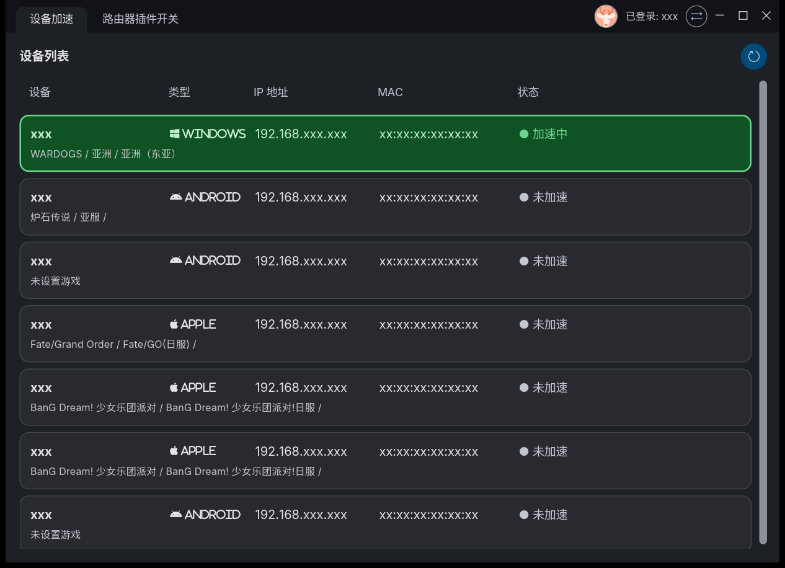
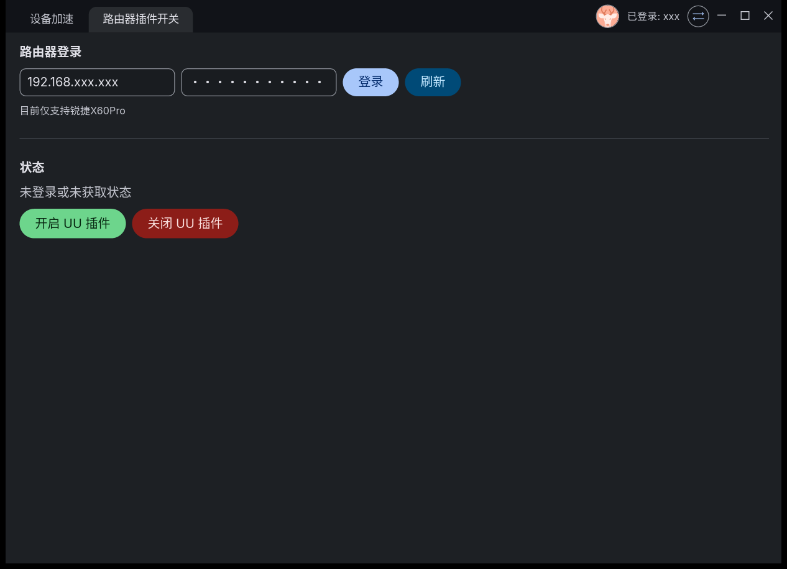

# uu-gui

[中文](README.md) | English

The unofficial **PC client for NetEase UU's "console acceleration"**
(UU主机加速) — manage acceleration for game consoles and other devices
behind your **Reyee (锐捷) router**, from your PC. Written in Rust with
[iced](https://github.com/iced-rs/iced) and the `tiny-skia` CPU renderer
(no GPU driver dependency).

> ⚠️ **Disclaimer** — this tool talks to NetEase / Reyee **private,
> reverse-engineered APIs** (`router.uu.163.com` and the router's local
> `luci` endpoint), using header/encryption constants extracted from the
> official UU Android app. It is for personal use on your own account and
> your own router. Using it may violate the respective EULAs; API changes
> on the service side may break it at any time. No affiliation with
> NetEase or Ruijie.

## Features

- **Device acceleration** — sign in with your UU account (SMS code), list
  every device on your router, pick game / zone / server, start / stop
  acceleration, per-device auto-acceleration toggle.
- **Router plugin switch** — log into the Reyee router locally (currently
  the X60 Pro family) and toggle the embedded UU plugin master switch.
- Frameless M3 dark window with native resize borders, DWM shadow and
  Win11 rounded corners; custom title bar drawn in-app.
- No GPU requirement: the whole UI renders on the CPU (tiny-skia).

## Screenshots

**Device list / acceleration**



**Router plugin switch**



## Build

```
rustup update stable
cargo build --release
target\release\uugui.exe
```

The build is self-contained: the local iced/winit forks the project
relies on are vendored under [`vendor/iced-src`](vendor/iced-src) and
[`vendor/winit-src`](vendor/winit-src) (see the `PATCHES.md` inside each
for the exact diffs and the reasons).

## Privacy notes

Your settings live in `~/.uu-gui/config.json` **on your own machine** —
nothing is uploaded anywhere by this repository. The file stores your
router address, admin password (base64-encoded, not encrypted), UU phone
number, session token and nickname. Don't commit or share that file.

## Structure

```
src/            application (Elm-style iced program)
vendor/iced-src rust fork of iced (perf + window patches, see PATCHES.md)
vendor/winit-src rust fork of winit (caption-rect fix, see PATCHES.md)
assets/         Font Awesome (brands) icon font, CC BY 4.0
```
